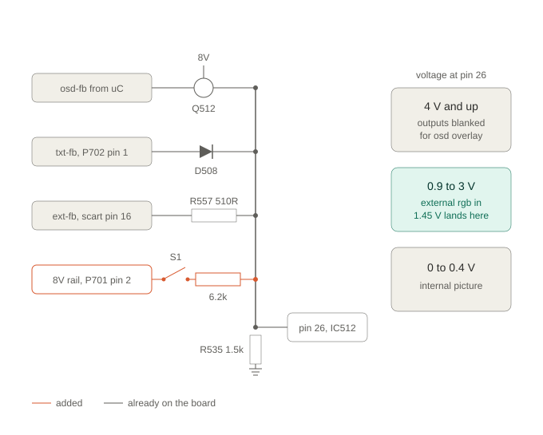
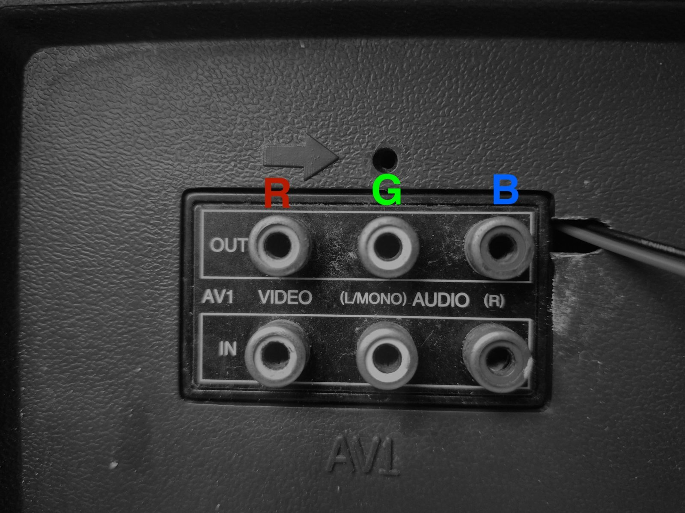
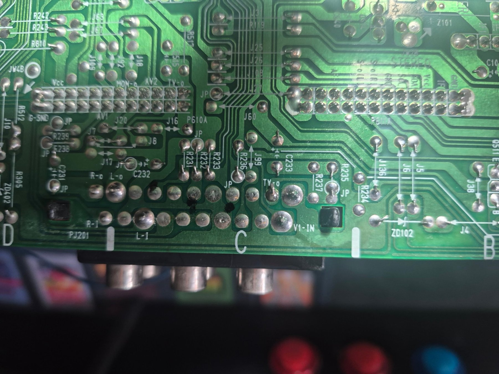
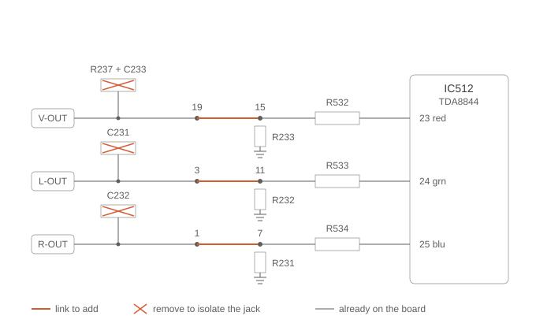
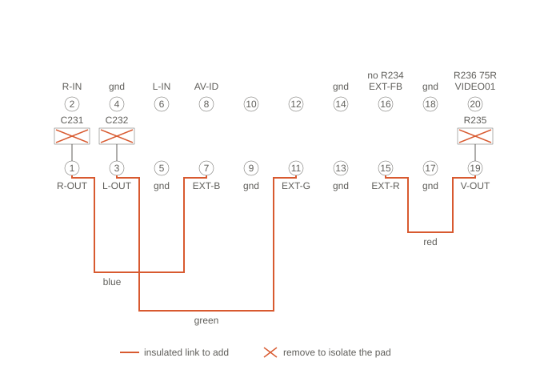

# LG CT-25M60 / CT-29M60 RGB mod (chassis MC-8CB) EASY RGB MOD

Adding an RGB input to an LG CRT television with AV out, but SCART footprint on the PCB. Rather than add, new jacks or a SCART connecter, I repurposed the rear AV monitor-out RCA jacks. 

There is no RGB mod thread, CRT Database entry or forum write-up for this chassis anywhere I could find. 

---

## Getting the service manual

| Document | Search for |
|---|---|
| CT-25M60 / CT-29M60 full service manual | `ct2529m60et` (ManualsLib) |
| MC-8CB chassis service sheet | `lg_chassis-mc-8cb.pdf` ([Elektrotanya](https://elektrotanya.com/lg_chassis-mc-8cb.pdf/download.html)) |
| MC-84A chassis service sheet, useful cross-reference | `lg_chassis_mc84a.pdf` ([Elektrotanya](https://elektrotanya.com/lg_chassis_mc84a.pdf/download.html)) |

The full manual is a 28-page scan with no text layer: schematics, exploded parts diagram, parts lists, adjustment procedures and the OPTION tables. No PCB layout, and no mechanical drawings.

Every diagram in this repo is redrawn from scratch rather than cropped from the manual, so you can follow the mod without it. You will want it for the parts lists and the full schematic.

---

## The thing that will waste your day

The hardware is four parts and about six joints. **The step that blocks you is a service-menu option bit.**

The µC holds the jungle's RGB insertion disabled (`IE1`) until `OPTION-1`'s **SCART** bit is set to `1`. Until you flip it, fast blanking on pin 26 can sit at exactly the right voltage and nothing happens: you keep seeing the composite picture and conclude the mod has failed.

The service manual annotates that bit as "SCART JACK (AV1) **with RGB Input**" versus "PHONE JACK (AV1)", which is the only clue it gives. That the bit gates insertion is inference from the symptom, not something the manual states, but on my set flipping it was the difference between no RGB and working RGB with nothing else changed.

---

## The set

| | |
|---|---|
| Models | LG CT-25M60 (25"), CT-29M60 (29") |
| Chassis | MC-8CB, 1999 |
| Jungle | Philips TDA8844 (parts list says TDA8843, same family and pinout) |
| Video output | TDA6108JF on the neck board |
| Tube | LG slot mask, shadow mask not aperture grille |
| Service manual | `ct2529m60et`, on Elektrotanya |

The manual is a scanned PDF with no text layer and no PCB layout, only schematics, an exploded parts diagram and parts lists.

---

## What the factory leaves out

This chassis uses one PCB artwork for both the SCART build and the phone-jack build, with selective population. On a phone-jack set:

**Fitted**

| Ref | Value | Function |
|---|---|---|
| R532, R533, R534 | 1.5k | Series into the jungle's RGB inputs |
| C516, C517, C518 | 22nF | Coupling into pins 23, 24, 25 |
| R535 | 1.5k | Fast blanking pull-down |
| R231, R232, R233 | 75R | Terminations on EXT-B, EXT-G, EXT-R |
| R236 | 75R | Termination on VIDEO01, the composite input |
| Q512 | KSC945C | OSD drive onto the blanking node |

**Not fitted**

| Ref | Value | Why it matters |
|---|---|---|
| PJ201 SCART | | Footprint present, connector absent |
| R557 | 510R | The blanking path. Use this footprint for your pull-up |
| R234 | 75R | Blanking termination. **Leave it out** |
| R237 | 62R | Links the monitor-out node to SCART pad 19 |
| J99, J70 | links | Build-option jumpers |
| D505 to D508 | 1N4148 | Teletext RGB and blanking injection |

There is a pattern here worth understanding. Everything LG removed sits on the **fast blanking** path. Leave R557 in on a set with no SCART socket and you have an unterminated open-ended PCB trace running into pin 26 through 510 ohms: pick up more than 0.9V anywhere inside a CRT chassis and the chip switches to RGB inputs that have nothing on them. Black screen, intermittent, no obvious cause.

Everything they left in does the opposite. The 75R terminations tie the unused EXT traces to ground, so pins 23, 24 and 25 sit at a defined black rather than floating.

---

## How fast blanking works on this chip

Pin 26 is a resistive summing node, not a logic input. Four things can drive it and nothing isolates them from each other. R535 1.5k is the default: with nothing driving, the node sits at 0V and the chip shows its internally decoded picture.

The TDA8843/8844 datasheet gives three bands:

| Pin 26 | Behaviour |
|---|---|
| 0 to 0.4V | No insertion, internal picture |
| 0.9 to 3.0V | External RGB inserted at pins 23, 24, 25, under contrast and brightness control |
| 4V and up | RGB outputs blanked, so OSD can be applied directly to the outputs |

That third band explains the chassis layout. The on-screen menu is **not** routed through the jungle: OSD R, G and B are diode-OR'd onto the jungle's *output* lines at pins 21, 20 and 19 through D501, D502 and D503. Q512 drives pin 26 above 4V so the chip's own picture gets out of the way, then the diodes paint the menu on.

Teletext, where fitted, uses the middle band instead: its RGB arrives at pins 23 to 25 through D505 to D507, so TXT-FB has to land between 0.9 and 3V, not above 4.

Three drivers, three different uses of one node.

---

## The mod

### Approach

The rear panel has six phono jacks: AV1 in (V, L, R) and monitor out (V, L, R). Keep the three inputs doing what they do, and repurpose the three **outputs** as the RGB inputs. You lose the ability to record off the TV, which nobody has done this century.

This beats fitting new jacks: no cabinet modification, and the runs drop from 200mm of harness to about 30mm on the board, which makes the noise question disappear entirely.

### Parts

| Part | Qty | Where |
|---|---|---|
| 5.1k 1% 0.25W metal film | 1 | R557 footprint |
| SPST toggle switch | 1 | Panel |
| Hookup wire | | Switch legs |

**The 75R terminations are already on the board.**

The pull-up value is not critical. With R535 measured at 1.4k in circuit, anything from **3.3k to 7k** lands pin 26 inside the insertion band with margin for an 8V rail at tolerance and a 5% resistor. 5.1k gives 1.72V, worst case 1.55 to 1.91V, which never approaches either threshold. 10k is too much: 0.98V nominal, and it falls under the 0.9V floor on a sagging rail.

### Remove, one part per jack

| Part | Value | Isolates |
|---|---|---|
| R235 | 62R | V-OUT jack from CVBS MNT |
| C232 | 22µF 16V | L-OUT jack from MNT OUT-L |
| C231 | 22µF 16V | R-OUT jack from MNT OUT-R |

Leave C233 in place. Removing R235 alone isolates the video jack. All three are reversible by refitting.

### Wire

The monitor-out jacks and the SCART footprint share nets, so you can link pad to pad on the footprint:

| Jack | From | To | Channel |
|---|---|---|---|
| V-OUT | Pad 19 | Pad 15 | Red |
| L-OUT | Pad 3 | Pad 11 | Green |
| R-OUT | Pad 1 | Pad 7 | Blue |

**Verify this on your board first.** C233's output node splits two ways, to R235 for the jack and to R237 for SCART pad 19, and on my set R237 was unpopulated. Beep each jack's centre pin to its SCART pad. If they beep, link pad to pad. If they don't, run a short wire from the jack's own pad to the SCART pad instead. Same electrical result.

Jack-to-colour is arbitrary, since you are labelling the back panel yourself. The mapping above is the one on the set photographed here, which keeps the panel order reading R, G, B left to right.

Note that the two audio-side links **cross** with this mapping. If you would rather they nest, swap them: pad 3 to pad 7 for blue and pad 1 to pad 11 for green, then label the panel to match.

**Use insulated wire.** All three links run along the odd pad row and pass over other pads, including grounds at 5, 9, 13 and 17. Not bare links, and certainly not solder bridges.

**Grounds come free.** The jack shells and SCART ground pads are the same copper, so there is no separate ground wiring at all.

**The board silkscreen names the jacks**, so you can identify everything from the board without tracing. Look for `V1-IN`, `L-I` and `R-I` on the AV1 inputs, and `TV-o`, `L-o` and `R-o` on the three monitor outputs you are repurposing. `PJ201` marks the connector.

*The AV1 block after the mod. The OUT row is now the RGB input, relabelled R, G, B. The IN row is unchanged: composite into VIDEO for sync, audio into L and R.*

*Solder side of the main board, the PJ201 area. R235 and R237 sit either side of C233, J99 is next to R236, R231 to R233 are in a row, and C231 and C232 are over by R305.*

### Blanking

Fit the 5.1k in the **R557 footprint**. The two pads:

- **Inner pad**: beeps to IC512 pin 26, reads about 1.4k to ground through R535. This is the node. Leave it.
- **Outer pad**: reads open on every range. Switch wire goes here.

Other side of the switch to **P701 pin 2**, the 8V rail. P701 is the teletext board's power and I2C header, unpopulated on a set without teletext, and conveniently sited next to the jungle. Pin 1 is GND, pin 2 is 8V, **pins 3 and 4 are SDA and SCL, so stay off them.** Confirm pin 2 by beeping it to Q512's 8V leg, then measure 8V on it with the set running.

Leave R234 and the J-position links empty. R234 is the 75R on the blanking line: fit it and it lands in parallel with R535, giving 71R, and the node drops to 0.09V. That is below the no-insertion threshold, so the chip never switches and you get composite forever with no clue why.

### Service menu  NB!

1. Enter SVC mode: press **OK on the TV set and OK on the remote at the same time**.
2. Press the **Yellow** button to cycle pages until `OPTION-1`.
3. Set **SCART** to `1`.
4. Exit by switching off **with the remote**, so the µC writes the EEPROM.

If your remote has no colour keys, you can use the 'Q.VIEW' button to cycle between screens.
---

## Sync and audio

Composite into the existing **V-IN** jack for sync, audio into **L-IN** and **R-IN**. Select AV1, then close the switch.

The sync separator and deflection run off whichever CVBS input is selected, and fast blanking only swaps the RGB matrix, so you get an RGB picture locked to the composite timing. Audio is switched by the A/V board and is completely independent of the blanking pin.

If your source outputs an uncoloured composite or luma alongside RGB, which many do, the composite picture will be black and white. That is fine and expected: with the switch closed the colour comes from the RGB lines and the composite only carries timing.

---

## Bring-up

Do these in order. The first two prove the blanking half without any RGB source attached.

1. **Switch open.** Normal picture. Press Menu and confirm the OSD looks as it always did. This is your reference.
2. **Switch closed, no source.** The screen should go **black**, with the menu still visible over it. That single test proves the blanking path, R535, the divider and Q512.
3. **Meter the node, switch closed.** About 1.7V with a 5.1k.
4. **Then the source.** Composite into V-IN, audio into L-IN and R-IN, select AV1, close the switch.

### Troubleshoot

| Symptom | Cause |
|---|---|
| Switch closed, composite picture unchanged | Insertion disabled. **Check the OPTION-1 SCART bit first.** Otherwise you are not on pin 26 |
| Switch closed, node reads ~0V | Break in the chain: no 8V at the tap, switch not closing, resistor not seated, wire not on the outer pad |
| Switch closed, node reads 0.4 to 0.9V | Resistor too large, or the 8V tap is a lower rail |
| Switch closed, node reads ~8V | Wire on the inner pad, bypassing the resistor |
| Black screen but the menu vanishes too | Q512 cannot lift the node past 4V. Check the resistor value |
| Menu present but very dim | Something loading the blanking node. Check R234 is empty |
| Wrong colours | SCART pad rows mirrored. Re-check 15, 11 and 7 |
| No lock or rolling | Composite not reaching AV1, or the set is not on AV1 |

**The meter beats the screen on every blanking fault.** A black screen is the correct result for both 1.7V and 8V, and they need opposite fixes.

---

## Tips

**The mod is global, not per-input.** Fast blanking sits downstream of source selection, so with the switch closed the set ignores whichever composite source is selected, including AV2 on the front. That is the price of one hardware switch.

**Identify pads by continuity, never by counting.** SCART footprints are trivially easy to mirror. Beep pad 20 to R236, pad 15 to R532, pad 11 to R533 and pad 7 to R534. If those four land correctly the rest of the map follows.

**Do not use the teletext header for RGB injection.** P702 carries TXT-R, TXT-G and TXT-B, but on this chassis they reach the jungle through series 1N4148s. Fine for teletext's eight saturated colours, and it will crush the bottom of an analogue RGB signal.

**Find the blanking node from the chip, not the connector.** IC512 pin 26 connects straight to it with nothing in series, so probing pin 26 against the R557 footprint identifies both pads at once. The pad that beeps is also the one reading 1.4k to ground.

---

## Service menu reference

Values for the 25 inch, from the manual.

**Deflection (LINE SVC-1)**

| | Function | Default | 25" LG |
|---|---|---|---|
| VL | Vertical linearity | 35 | 34 |
| VS | Vertical shift | 20 | 31 |
| VA | Vertical amplitude (height) | 43 | 32 |
| HS | Horizontal shift | 31 | 33 |
| SC | Vertical S correction | 10 | 13 |
| EW | East-west (width) | 39 | 37 |
| EP | EW parabola | 22 | 25 |
| EC | EW corner | 23 | 09 |
| ET | EW trapezoid | 32 | 30 |

**White balance (LINE SVC-0)**

| | Function | Default | 25" LG |
|---|---|---|---|
| RG | R-drive | 35 | 32 |
| GG | G-drive | 31 | 31 |
| BG | B-drive | 27 | 27 |

Set GG to 31 as the reference, then trim RG and BG for x=0.281, y=0.288 on a 100% white field. That is roughly 9300K, the period-correct target.

Press **OK to memorise** on every page. Change a value and leave without pressing OK and it reverts.

**OPTION-1 bits**: COMB (32), TILT (16), SCART (8), AV2 (4), SYSTEM (0 to 3).
**OPTION-2 bits**: FFI/CK, CHINA, LANG, HOTEL, EYE. The EYE bit disables the CdS ambient light sensor, which is worth turning off for a gaming set: it fights you every time you calibrate.

There is no gamma control on this chassis.

---

## Sources

- LG `ct2529m60et` service manual (chassis MC-8CB), Elektrotanya
- LG `lg_chassis_mc84a` service sheet (chassis MC-84A), Elektrotanya, as a cross-reference
- Philips TDA8843/TDA8844 device specification, for the pin 26 insertion thresholds and the `IE1` insertion enable bit
- The shmups.system11.org TV RGB mod thread, for the MC-84A write-up that got me to the right part numbers

Worked out with Claude (Anthropic).

## Licence

Public domain. Do what you like with it.
